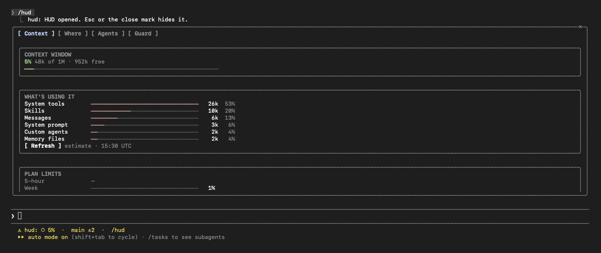
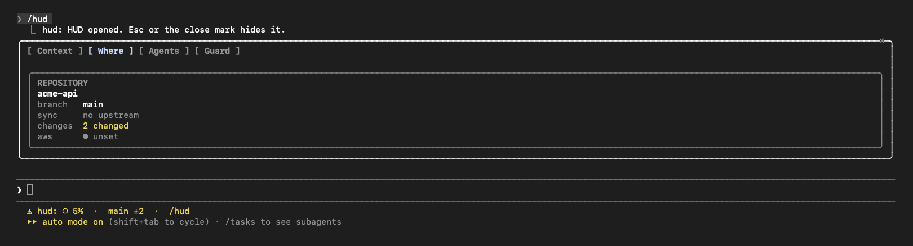
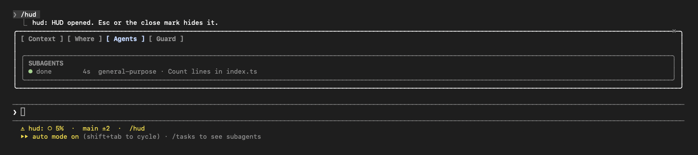
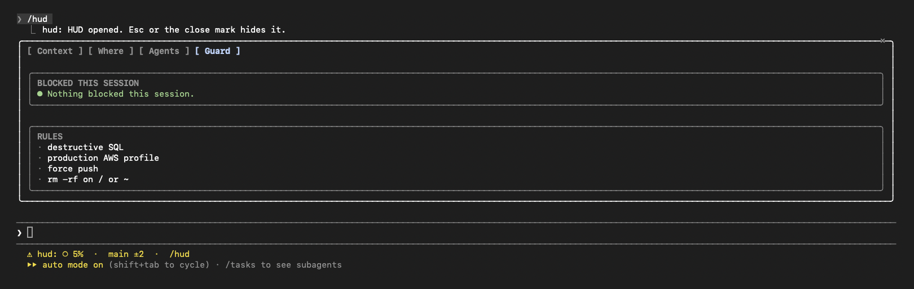

# hud

**A quiet heads-up display for Claude Code.**

Long sessions go wrong in quiet ways. The context window fills up and you only notice when answers get worse. A subagent finishes in the background and nobody looks. Claude reaches for a force push or the wrong AWS profile. `hud` keeps an eye on all of that and stays out of the way until something needs you.



## What you get

**A status chip under the prompt.** Always on, one line: a context dial that fills as the window does (`○ 5%`, `◑ 48%`, `● 95%`), your branch, and how many files have uncommitted changes (`main ±2`).

**Nudges, not noise.**
- A toast when context crosses 80% and again at 90%, with roughly how many tokens are left.
- A band above the prompt once context passes 85%, with a meter, so you can wrap up or start fresh before quality drops.
- A toast when a subagent finishes or stops, with how long it took.

**A guard for risky commands.** Before Claude runs a Bash command, `hud` checks it against a few rules: destructive SQL (`DROP TABLE`, `TRUNCATE`), a production AWS profile, `git push --force`, and `rm -rf` on `/` or `~`. A match is refused, and Claude is told to give you the exact command so you can run it yourself if you mean it.

**The `/hud` pane.** Type `/hud` for the full picture, in four tabs.

| Tab | What it shows |
| --- | --- |
| **Context** | How full the window is, what's filling it (system tools, skills, messages, MCP servers), and your 5-hour and weekly plan limits and cost. |
| **Where** | Repository, branch, sync with upstream, uncommitted changes, and the active `AWS_PROFILE`: green for read-only, red for anything named prod. |
| **Agents** | Subagents this session: running, done or stopped, with how long each took. |
| **Guard** | What was blocked this session, and the rules. |







Press `ctrl+x` then `tab` to focus the pane, `1` to `4` to switch tabs, `r` to refresh the breakdown, and `esc` to close it.

## Install

At the prompt of a Claude Code terminal session:

```
/plugin install hud --marketplace prodij/claude-hud
```

Answer `y` to add the marketplace, then pick the user scope. From a shell:

```bash
claude plugin install hud --marketplace prodij/claude-hud
```

In the desktop app: click + next to the prompt box, then Plugins, Add marketplace with `prodij/claude-hud`, then Add plugin.

Needs a recent Claude Code with function-hook plugins (built and tested on 2.1.309).

## Develop

```bash
claude plugin validate .
claude plugin test .
claude --plugin-dir .
```
